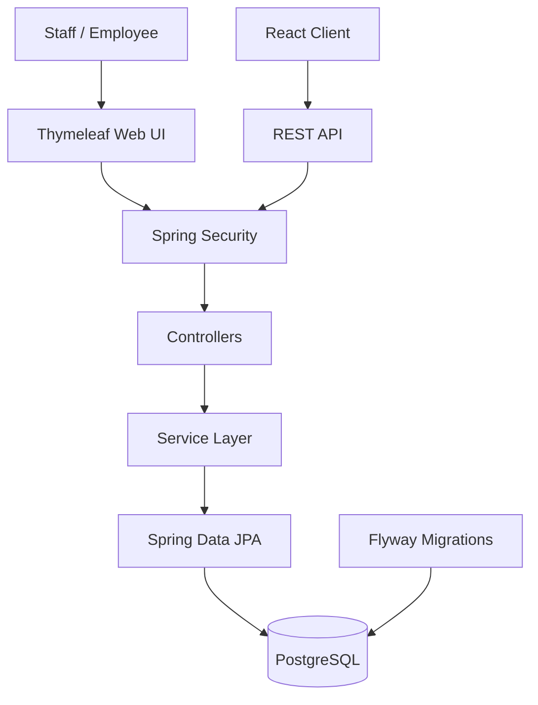
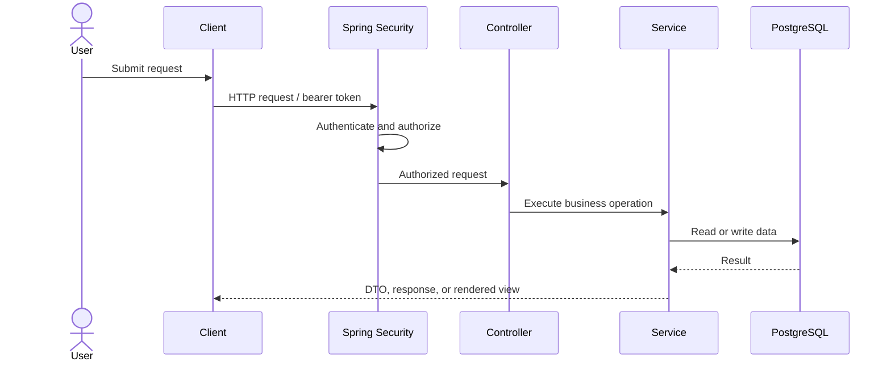

# Employee Management System

A role-based HR and workforce management application built with **Java 21, Spring Boot, Spring Security, PostgreSQL, and Thymeleaf**. It combines server-rendered pages with REST endpoints for client integrations.

> **Status:** Portfolio project. Review the security, privacy, and operational configuration before using real employee data.

## Overview

The system separates administration and HR workflows from employee self-service. A separate React client is maintained in [ems_frontend](https://github.com/robinmwaniki/ems_frontend).

## Features

- Employee and department management.
- Role-based user administration.
- Attendance records and leave management.
- Payroll records and payroll views.
- Announcements and notifications.
- Performance records and reporting.
- PDF-oriented report views and system activity logs.
- Employee dashboard, profile, attendance, leave, payroll, notifications, and password-change workflows.
- JWT authentication, request validation, DTOs, and role-based authorization.
- PostgreSQL persistence with Flyway migrations.
- Docker image, Docker Compose, Actuator health endpoints, and OpenAPI integration.

## Architecture

The application follows a layered Spring architecture: controllers handle HTTP requests, services implement business rules, repositories access the database, and JPA entities represent persisted data.



### Request lifecycle



## Technology stack

| Area | Technology |
| --- | --- |
| Language | Java 21 |
| Framework | Spring Boot 4.1.1 |
| Web | Spring MVC, Thymeleaf |
| Security | Spring Security, JJWT |
| Persistence | Spring Data JPA, Hibernate |
| Database | PostgreSQL 17 |
| Migrations | Flyway |
| API docs | Springdoc OpenAPI |
| Operations | Spring Boot Actuator |
| Build / containers | Maven Wrapper, Docker, Docker Compose |
| Testing | Spring Boot Test, Testcontainers |

## Getting started

### Prerequisites

- Git
- Docker Engine and Docker Compose plugin
- Java 21 and PostgreSQL 17 if running outside Docker

### 1. Clone

```bash
git clone https://github.com/robinmwaniki/employment-management-system.git
cd employment-management-system
```

### 2. Create a local .env file

The Compose configuration expects a root-level `.env` file. Create it locally and do not commit it:

```dotenv
DB_USERNAME=ems
DB_PASSWORD=replace-with-a-strong-local-password
JWT_SECRET=REPLACE_WITH_BASE64_ENCODED_32_BYTE_OR_LONGER_SECRET
JWT_EXPIRATION_MS=3600000
MAIL_HOST=smtp.gmail.com
MAIL_PORT=587
MAIL_USERNAME=
MAIL_PASSWORD=
CORS_ALLOWED_ORIGIN=http://localhost:5173
```

Generate a strong Base64 secret instead of using the placeholder:

```bash
openssl rand -base64 32
```

### 3. Start the stack

```bash
docker compose up --build
```

The Compose stack starts PostgreSQL and the Spring Boot application. Wait for the database health check and application startup to complete.

### 4. Open the application

- Application: [http://localhost:8080](http://localhost:8080)
- Health: [http://localhost:8080/actuator/health](http://localhost:8080/actuator/health)

Stop the stack with `docker compose down`. Use `docker compose down -v` only when you intend to delete the local database and upload volumes.

## Configuration

| Variable | Purpose |
| --- | --- |
| `DB_URL` | PostgreSQL JDBC URL |
| `DB_USERNAME`, `DB_PASSWORD` | Database credentials |
| `JWT_SECRET` | Base64 HMAC signing key of at least 256 bits |
| `JWT_EXPIRATION_MS` | Token lifetime in milliseconds |
| `PORT` | HTTP port; defaults to 8080 |
| `CORS_ALLOWED_ORIGIN` | Allowed browser origin |
| `MAIL_HOST`, `MAIL_PORT` | SMTP server settings |
| `MAIL_USERNAME`, `MAIL_PASSWORD` | SMTP credentials |

Compose configures the database URL for its internal network. For a locally installed database, use a JDBC URL reachable from the host.

## Database migrations

Flyway migration scripts live in `src/main/resources/db/migration/`. Flyway owns schema changes; Hibernate is configured with `ddl-auto: validate` and checks the mapped schema. Add a migration whenever the database structure changes.

## Security model

| Role | Intended access |
| --- | --- |
| `ROLE_ADMIN` | Administrative access |
| `ROLE_HR_MANAGER` | HR and workforce management |
| `ROLE_EMPLOYEE` | Employee self-service |

API clients authenticate with:

```http
Authorization: Bearer <access-token>
```

Do not commit real credentials, JWT secrets, SMTP passwords, or production tokens.

## Testing

**macOS / Linux**
```bash
./mvnw test
```

**Windows**
```powershell
.\mvnw.cmd test
```

The repository includes security-rule, migration, page-rendering, and Spring Boot tests, plus Testcontainers-based PostgreSQL test support. Docker is required for tests that start database containers.

## API documentation and health

Actuator exposes health and info endpoints. OpenAPI is disabled by default and can be enabled with `SWAGGER_ENABLED` in a trusted development environment. The Swagger UI path is typically `/swagger-ui/index.html`.

## Deployment

For a hosted environment, provision managed PostgreSQL, configure secrets through the host's secret manager, use HTTPS, restrict CORS to trusted frontend origins, and provide persistent or object storage for uploaded files. Do not reuse local Compose credentials or development settings in production.

## Project structure

```text
src/
├── main/java/com/ems/
│   ├── config/       # Security, CORS and application configuration
│   ├── controller/   # HTTP and page controllers
│   ├── dto/          # Request and response models
│   ├── entity/       # JPA entities
│   ├── repository/   # Persistence interfaces
│   └── service/      # Business logic
├── main/resources/
│   ├── db/migration/ # Flyway migrations
│   ├── static/       # Static assets
│   └── templates/    # Thymeleaf pages
└── test/             # Automated tests
Dockerfile
docker-compose.yml
pom.xml
mvnw / mvnw.cmd
```

## Security and license

This project is not a certified HR or payroll platform. Conduct a security review and validate applicable privacy and employment-data requirements before processing real employee information.

No license file is currently declared. Unless a license is added, standard copyright restrictions apply.

## Maintainer

**Robin Mwaniki** · [GitHub](https://github.com/robinmwaniki)
